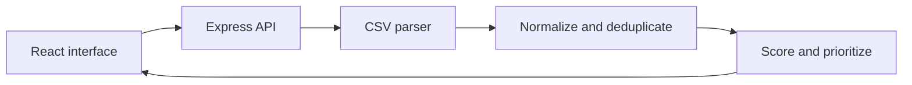

# SignalQueue

**Explainable lead prioritization for teams that already have the data, but still need to decide what to do next.**

SignalQueue is a time-boxed full-stack prototype built for the Caprae Capital Full Stack Developer challenge. It takes a CSV of enriched company leads, removes duplicates, scores each lead against a configurable ideal customer profile, and places it into one of four clear action queues:

- **Contact Now**
- **Verify First**
- **Contact Later**
- **Skip**

The goal is not to replace SaaSquatch or build another general-purpose scraper. The goal is to add a focused decision layer after enrichment, so a user can move from a large lead list to a defensible next action without another spreadsheet workflow.


## Why I built this

While reviewing the public SaaSquatch product, demo, and pricing material, I found a strong workflow for finding companies, enriching contact data, exporting lists, and beginning outreach. The product already covers company search, filters, revenue estimates, contact information, AI-assisted scoring, email generation, LinkedIn access, and other engagement tools.

That made another scraper or email generator feel repetitive. The more useful question was:

> Once a user has hundreds of enriched leads, which ones deserve attention first, which ones need verification, and why?

SignalQueue answers that question by separating **business fit** from **data confidence**. A company can be a strong target while still having incomplete contact data. Keeping those two ideas separate prevents a high-potential company from being discarded and prevents unreliable data from being treated as outreach-ready.

This also reflects a theme in Caprae's public writing: execution slows down when information has to pass through too many manual steps. Instead of exporting a list, cleaning it, checking duplicates, comparing it with a buy box, and asking someone what to do next, SignalQueue makes the reasoning visible in one workflow.

## Reference application analysis

### Business purpose

SaaSquatch helps entrepreneurs, searchers, and sales teams discover companies, enrich company and contact records, and move those records toward outreach. Its value is not simply the number of rows collected; it is the amount of useful outreach-ready information produced per unit of time and enrichment cost.

### Strengths I observed

- An end-to-end path from company discovery to engagement
- Company and contact enrichment in one product
- Filters for industry, geography, size, and other firmographics
- Revenue estimation and company scoring
- Direct access to company websites and LinkedIn profiles
- Email-generation and outreach support
- CSV/Excel export for existing workflows
- A clear, modern, data-focused interface

### Opportunity addressed by this prototype

Based on the accessible public material, I did not see the full reasoning behind a score or a clear separation between target fit and record reliability. I also did not see an explicit action queue that explains whether a lead should be contacted, verified, saved for later, or skipped.

SignalQueue focuses on that narrow opportunity. This is an observation from the accessible demo and public pages, not a claim that the production platform has no related internal functionality.

## Product decision: Quality First

I chose the **Quality First** approach and built one complete workflow instead of several unrelated mini-tools.

With a short build window, this allowed me to spend time on the parts that make the feature credible:

- A configurable target profile
- Deterministic and explainable scoring
- Duplicate detection and record merging
- Data-quality checks
- Useful filters and search
- Safe CSV export
- Loading, empty, and error states
- Automated tests
- A polished responsive interface

The core engine is intentionally deterministic. SaaSquatch already presents AI-assisted scoring and outreach features, and adding another opaque model in a short prototype would make the decision harder to audit. The current rules can later be complemented by an AI classifier for unstructured website text without making the basic workflow dependent on an API key.

## How it works

1. The user defines an ideal customer profile: industries, locations, revenue range, and employee range.
2. The user uploads a permitted CSV export.
3. The API validates and parses the file in memory.
4. Lead fields are normalized into a consistent structure.
5. Duplicate companies are merged using normalized website domains, with a company-and-location fallback.
6. Each lead receives a Fit Score and a Confidence Score.
7. Leads are sorted into an action queue with visible reasons and verification notes.
8. The user can search, filter, inspect, and export the currently visible results.

## Scoring model

### Fit Score

Fit answers: **Is this the kind of company we want to contact?**

| Signal | Weight |
| --- | ---: |
| Industry match | 30 |
| Location match | 20 |
| Revenue within target range | 20 |
| Employee count within target range | 15 |
| Decision-maker contact available | 15 |
| **Total** | **100** |

### Confidence Score

Confidence answers: **Is this record complete enough to act on?**

| Signal | Weight |
| --- | ---: |
| Website has a valid domain | 20 |
| Email has a valid structure | 20 |
| Email domain matches website domain | 10 |
| Phone is present | 10 |
| LinkedIn URL is present and valid | 10 |
| Contact name is present | 10 |
| Industry, location, revenue, and employee fields | 20 |
| **Total** | **100** |

An email passing the structural check is **not** presented as proof of deliverability. It is only one confidence signal.

### Action rules

| Rule | Action |
| --- | --- |
| Fit >= 75 and Confidence >= 70 | Contact Now |
| Fit >= 75 and Confidence < 70 | Verify First |
| Fit between 50 and 74 | Contact Later |
| Fit below 50 | Skip |

Every result includes positive reasons and unresolved issues, so the user can understand the output instead of trusting an unexplained number.

## Current prototype result

The included synthetic dataset contains 10 rows, including one duplicate and several incomplete records.

| Result | Count |
| --- | ---: |
| Rows analyzed | 10 |
| Unique leads | 9 |
| Duplicates removed | 1 |
| Contact Now | 4 |
| Verify First | 1 |
| Contact Later | 2 |
| Skip | 2 |

Changing the target profile recalculates the results. For example, changing the target to Healthcare companies in California moves Peak Dental to a Fit Score of 100, while its incomplete contact data keeps it in Verify First.

## UX decisions

- **One main flow:** define, upload, review, and export on one page
- **Separate scores:** Fit and Confidence are never collapsed into one opaque value
- **Visible reasoning:** each selected lead shows matching factors and verification issues
- **Action language:** queue labels describe what the user should do next
- **Progressive detail:** summary cards provide an overview; the table and detail panel provide evidence
- **Accessible status cues:** status is communicated through text and icons, not color alone
- **Responsive layout:** the criteria panel and results stack on smaller screens
- **Safe export:** spreadsheet-formula prefixes are neutralized before CSV download

## Architecture



### Technology choices

| Layer | Technology |
| --- | --- |
| Frontend | React, Vite, Tailwind CSS |
| UI utilities | Lucide React |
| API client | Axios |
| Backend | Node.js, Express |
| File upload | Multer with in-memory storage |
| CSV parsing | csv-parse |
| Validation | validator plus explicit file checks |
| Testing | Node.js built-in test runner |

### Data-storage strategy

The current prototype is intentionally **stateless**. Uploaded lead data is processed in memory and returned to the browser; it is not written to a database. This keeps the four-and-a-half-hour prototype simple and avoids retaining potentially sensitive contact data without an agreed retention policy.

For production, I would use **MongoDB Atlas** with three collections:

- `scoring_profiles` for reusable target criteria and weights
- `analysis_runs` for counts, status, timing, and audit metadata
- `leads` only when a customer explicitly enables persistence

Production indexes would include a unique run-and-deduplication key and an index on run, priority, Fit Score, and Confidence Score. A TTL policy would remove temporary imports automatically.

### Caching and performance

Implemented in the prototype:

- 2 MB upload limit
- In-memory upload rather than writing temporary files to disk
- Single-pass `Map`-based deduplication, approximately O(n)
- Batch scoring and one final sort
- Client-side filtering after one API response
- Production build verified with Vite

For a production version, I would add Redis/Upstash caching keyed by a hash of the file plus scoring criteria, background jobs for large imports, streaming CSV parsing, server-side pagination, and rate limiting.

### Hosting and deployment plan

- **Frontend:** static Vite build on Vercel
- **Backend:** Node/Express web service on Render
- **Production database:** MongoDB Atlas
- **Production cache:** Upstash Redis
- **Deployment:** GitHub-connected automatic deployments from `main`
- **Configuration:** environment variables for the frontend API URL, allowed origin, port, and future database/cache credentials

The frontend and backend are separated so they can scale and deploy independently.

## API

### Health check

```http
GET /api/health
```

### Analyze leads

```http
POST /api/leads/analyze
Content-Type: multipart/form-data
```

Form fields:

- `file`: CSV file
- `criteria`: JSON string containing industries, locations, revenue limits, and employee limits

The response contains import counts, priority counts, and the scored lead records with reasons and issues.

## Local setup

### Requirements

- Node.js 20 or newer
- npm

### 1. Clone and install

```bash
git clone https://github.com/Dhruvmehta0708/caprae-signalqueue.git
cd caprae-signalqueue

cd server
npm install

cd ../client
npm install
```

### 2. Configure the backend

Create `server/.env`:

```env
PORT=5000
CLIENT_URL=http://localhost:5173
```

### 3. Configure the frontend

Create `client/.env`:

```env
VITE_API_URL=http://localhost:5000/api
```

### 4. Start the API

```bash
cd server
npm run dev
```

The API runs at `http://localhost:5000`.

### 5. Start the frontend

Open another terminal:

```bash
cd client
npm run dev
```

Open `http://localhost:5173`.

## CSV format

The included file at `sample-data/leads.csv` is synthetic and safe to publish.

Required header format:

```csv
company,website,industry,location,revenue,employees,contactName,email,phone,linkedin
```

No real personal contact information should be committed without permission.

## Testing

Run backend tests:

```bash
cd server
npm test
```

Current automated coverage verifies:

- Duplicate companies are merged correctly
- A complete high-fit lead becomes Contact Now
- A high-fit but incomplete lead becomes Verify First

Run frontend checks:

```bash
cd client
npm run lint
npm run build
```

Verified during development:

- 3 backend tests passing
- ESLint passing with no errors
- Production frontend build completing successfully
- Search and priority filters
- Filter-aware CSV export
- Empty, loading, and API-error states
- No browser-console errors during the main workflow

## Security and ethical handling

- Only CSV files are accepted, with a 2 MB size limit
- Uploaded files remain in memory and are not persisted
- Exported spreadsheet cells beginning with `=`, `+`, `-`, or `@` are neutralized to reduce CSV formula-injection risk
- The sample dataset is synthetic
- The tool does not bypass CAPTCHAs, access controls, or website restrictions
- A production scraper should respect source terms, robots policies, rate limits, and applicable privacy law
- A structurally valid email is not labelled as verified or deliverable

## Known limitations

- This prototype analyzes an existing CSV; it does not scrape live websites
- Scoring weights are manually defined rather than learned from campaign outcomes
- Records are not persisted between sessions
- Email checks are structural and domain-based, not mailbox-verification checks
- There is no user authentication, team workspace, CRM write-back, or live outreach
- Very large files would require streaming, background processing, and pagination

These choices were deliberate to keep the short build focused on one complete business workflow.

## What I would build next

1. Save and share scoring profiles across a team
2. Add field-level source and freshness information
3. Learn weight suggestions from reply and conversion outcomes while keeping the final score explainable
4. Add CRM export/write-back for qualified leads
5. Add optional website-text classification when firmographic fields are missing
6. Add background processing and cached results for large imports

## Project structure

```text
caprae-signalqueue/
├── client/
│   └── src/
│       ├── components/
│       ├── services/
│       └── App.jsx
├── sample-data/
│   └── leads.csv
├── server/
│   ├── src/
│   │   ├── routes/
│   │   ├── services/
│   │   └── server.js
│   └── test/
│       └── leadScoring.test.js
└── README.md
```

## References

- [SaaSquatch Leads](https://www.saasquatchleads.com/)
- [Caprae Capital](https://www.capraecapital.com/)
- [What Is Communication Overhead — And Why It Kills Growth](https://capraecapitalpartners.substack.com/p/what-is-communication-overhead-and)
- [Six Months at Caprae Capital: What Actually Matters](https://capraecapitalpartners.substack.com/p/six-months-at-caprae-capital-what)

## Author

**Dhruv Mehta**  
Full Stack Developer
